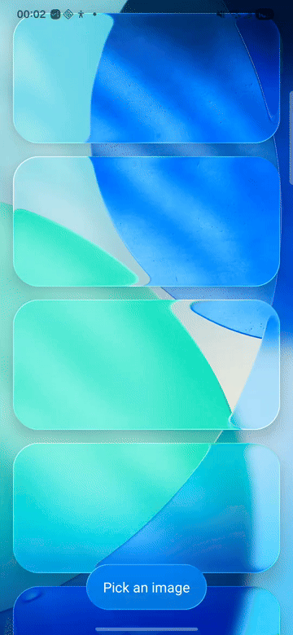
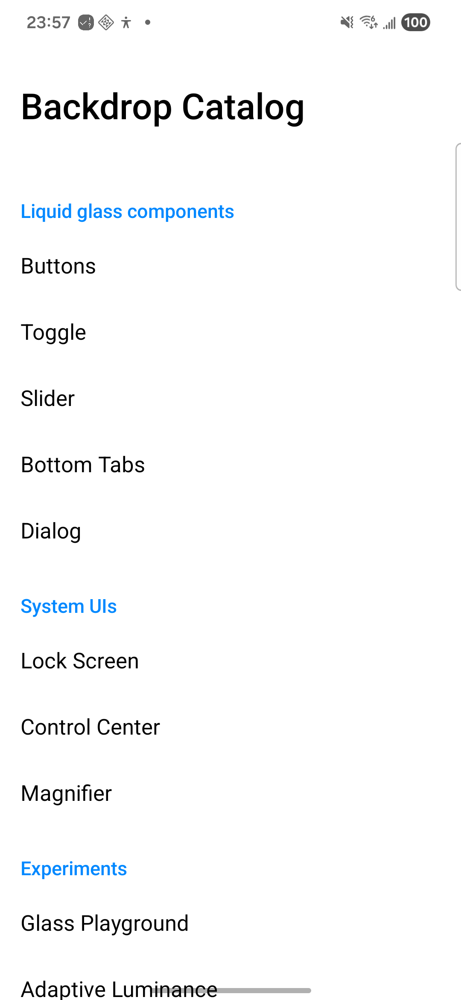
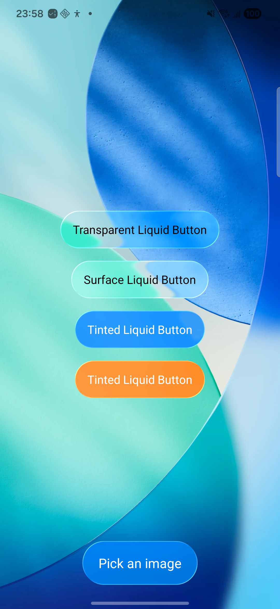
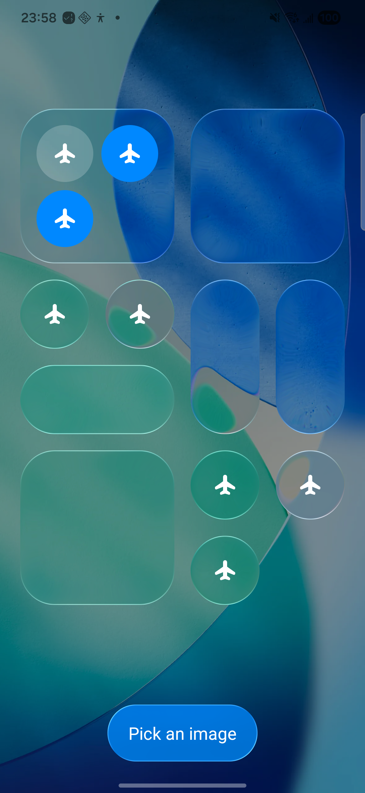
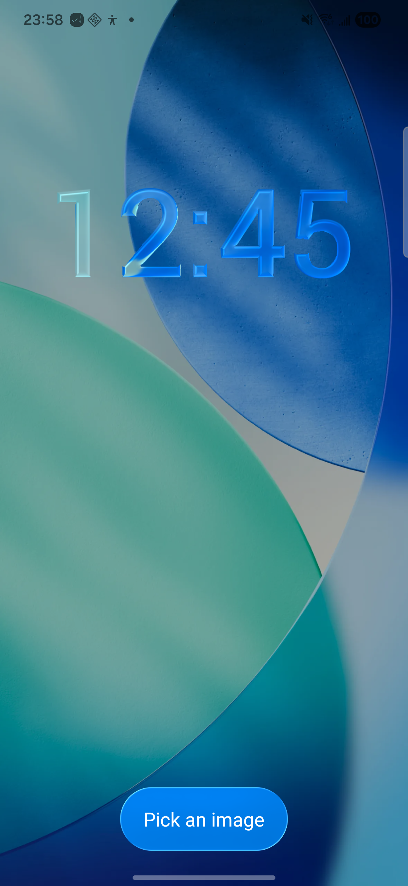
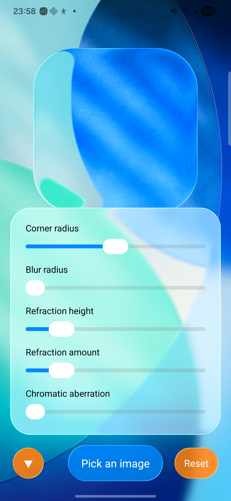
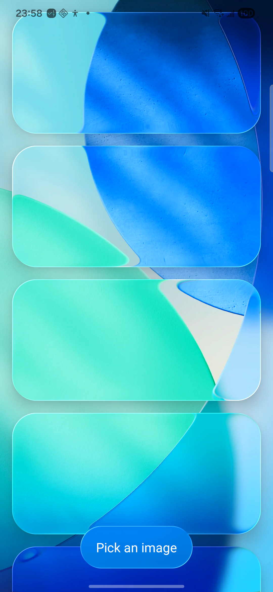

# Android View Liquid Glass

[](https://jitpack.io/#Citrussss/AndroidViewLiquidGlass)

AndroidLiquidGlass / Backdrop 的 Android View 实现。Java 17，`Canvas`、`RenderNode`、`RenderEffect` 与 `RuntimeShader`；不依赖 Compose、Kotlin、AndroidX UI 或第三方渲染库。

## 演示效果

Samsung SM-S9010 / Android 16 真机实拍：滚动玻璃卡片实时采样壁纸，外扩阴影自然显示。录屏仅包含 Demo 内部画面。



[查看 MP4 录屏](docs/images/scroll-container.mp4)

<p>
  
  
  
</p>
<p>
  
  
  
</p>

[下载 Demo APK 和 Library AAR](https://github.com/Citrussss/AndroidViewLiquidGlass/releases/latest) · [验证记录](VALIDATION.md)

完整折射效果需要 Android 13+；较低版本提供降级渲染。Demo 布局和部分动画为原生 View 重写，不保证逐像素匹配 Compose 版本。

## 工程

- `glass`：可独立集成的 Android library。
- `demo`：目录与 13 个演示页面，共 14 个目的地。
- `demo/src/androidTest`：无需第三方测试框架的真机 GPU 渲染检查。

## 构建与运行

使用 JDK 17、Android SDK 34。Android Studio 的 JBR 也可以使用。

```powershell
.\gradlew.bat :demo:assembleDebug :glass:assembleDebug
adb install -r demo\build\outputs\apk\debug\demo-debug.apk
adb shell am start -n com.kyant.backdrop.view.demo/.MainActivity
```

APK：`demo/build/outputs/apk/debug/demo-debug.apk`。
AAR：`glass/build/outputs/aar/glass-debug.aar`。

## 集成

将 `glass` 作为 module 引入，或将 AAR 加入现有 Android 工程。Java 和 Kotlin 调用同一组原生 View API。

```java
BackdropLayout root = new BackdropLayout(context);
// 图片、普通布局、ScrollView 或 ListView 都可以作为背景。
root.content().addView(background, new FrameLayout.LayoutParams(-1, -1));

LiquidButton button = new LiquidButton(context);
button.setText("Liquid Glass");
button.style.blur = 8;                 // dp
button.style.refractionHeight = 20;    // dp
button.style.refractionAmount = 28;    // dp
button.style.chromaticAberration = true;
root.foreground().addView(button, new FrameLayout.LayoutParams(280, 160));
button.setOnClickListener(v -> { /* 普通 Android 点击事件 */ });
```

上述 LayoutParams 使用 Android 原生 px 单位；`GlassStyle` 的长度参数使用 dp。更新 `style` 后调用 `invalidate()`。

`GlassView` 是 `FrameLayout`，可以添加任意普通 View 子控件；效果只作用于背景采样，子控件保持清晰。默认查找最近的 `BackdropLayout`，也可调用 `setBackdrop(root)` 指定背景。

XML 可使用 `GlassView`，支持 `glassRadius`、`glassBlur`、`glassTint`、`glassRefractionHeight`、`glassRefractionAmount`、`glassChromaticAberration` 属性。XML 中的玻璃应加入 `root.foreground()`，背景加入 `root.content()`。

```kotlin
val panel = GlassView(context)
panel.style.radius = 24f
panel.style.blur = 12f
panel.addView(TextView(context).apply { text = "Native View" })
root.foreground().addView(panel)
```

## 渲染与图层

1. `BackdropLayout` 将背景 View 树记录到一个共享 RenderNode，并绘制前景层。玻璃不进入背景录制，避免递归反馈。
2. `GlassView` 将背景映射到自己的坐标系，包含滚动、位移、缩放和旋转，按模糊与折射范围扩大采样区域。
3. 后台图层依次应用模糊、颜色控制、圆角 SDF 折射与七色采样色散。裁剪、表面色、内阴影、高光与原生 elevation 阴影在 View 层完成。
4. `setBackdropLayers(glassA, glassB)` 可以叠加其他玻璃导出的表面；导出的表面不包含子控件。滑条与开关的玻璃滑块用它采样轨道，避免采样自身。
5. API 31+ 可用 `setBackdropEffect(RenderEffect)` 添加自定义背景效果；API 33+ 可用 `setSdfTexture(Bitmap)` 使用距离场纹理折射。

效果和采样都在应用自己的 View 树内；SurfaceView、独立视频表面、其他窗口不属于此背景录制。

## 能力与兼容性

| 能力 | Android 13+ / API 33+ | Android 12 / API 31–32 | Android 6–11 / API 23–30 |
| --- | --- | --- | --- |
| 背景对齐、普通 View 子控件、交互组件 | 支持 | 支持 | 支持 |
| GPU 模糊、颜色控制、自定义 RenderEffect | 支持 | 支持 | 使用未模糊背景与表面色 |
| SDF 折射、七色采样色散、方向高光 | 支持 | 使用普通高光边缘 | 使用普通高光边缘 |
| SDF 时钟、Alpha 遮罩渐变模糊 | 支持 | 时钟文字回退；无遮罩效果 | 时钟文字回退；无遮罩效果 |
| 自适应亮度 | 背景缩略图采样与颜色/模糊调整 | 同左 | 保留普通背景 |

需要硬件加速才能使用完整 GPU 效果。最低版本上的回退没有模拟折射或 CPU 模糊。

`GlassStyle` 还支持四角半径、亮度、对比度、饱和度、背景透明度、缩放、高光角度/宽度/衰减、内阴影、Alpha 遮罩渐变模糊和附加的可变半径模糊。自适应亮度以 5×5 背景缩略图采样，不读取整屏 GPU 像素。

## Demo 对照

| 原目录 | View 实现 |
| --- | --- |
| Buttons | 透明、磨砂、染色与色散按钮，按压回弹 |
| Toggle | 原生 Checkable，点击/拖动、玻璃滑块、无障碍状态 |
| Slider | 拖动、键盘与无障碍数值设置、玻璃滑块 |
| BottomTabs | 标签切换与选中反馈 |
| Dialog | 应用内玻璃弹层与关闭交互 |
| LockScreen | 使用原 `clock_sdf.webp` 与 SDF 折射着色器的可拖动时钟 |
| ControlCenter | 原生开关、音量/亮度滑条与玻璃面板 |
| Magnifier | 可拖动放大镜 |
| GlassPlayground | 模糊、圆角、折射、饱和度、高光、缩放、色散参数与变换手势 |
| AdaptiveLuminanceGlass | 背景亮度采样、自适应颜色与模糊 |
| ProgressiveBlur | 原 Alpha 遮罩渐变模糊，以及额外的可变半径演示 |
| ScrollContainer | ScrollView 背景与固定玻璃面板 |
| LazyScrollContainer | 200 项 ListView 复用列表与固定玻璃面板 |

页面复用原壁纸，并可通过系统文件选择器更换背景图片。演示布局和部分原生手势/动画实现重新设计，并非原 Compose Demo 的逐像素截图复刻。系统界面为效果演示，不修改系统 Wi-Fi、亮度或锁屏。

## 真机检查

```powershell
.\gradlew.bat :demo:assembleDebug :demo:assembleDebugAndroidTest
adb install -r demo\build\outputs\apk\debug\demo-debug.apk
adb install -r demo\build\outputs\apk\androidTest\debug\demo-debug-androidTest.apk
adb shell am instrument -w com.kyant.backdrop.view.demo.test/com.kyant.backdrop.view.demo.CatalogInstrumentation
```

检查遍历全部 14 个目的地，触发真实 GPU 绘制并保存截图，验证开关、滑条和标签状态。截图保存在设备应用外部文件目录 `screenshots` 下。它是渲染与基本交互检查，不等同于所有 Android 版本和 GPU 的兼容性认证。

## 来源与许可

折射、色散、圆角 SDF、高光和纹理 SDF 算法移植自 Kyant 的 AndroidLiquidGlass / Backdrop；保留 Apache-2.0 许可，见 `LICENSE` 和 `NOTICE`。壁纸、时钟 SDF 纹理来自源项目。该工程的 View 容器、原生组件和目录应用为独立实现。

## Maven / JitPack

在项目的 `settings.gradle.kts` 中添加仓库：

```kotlin
dependencyResolutionManagement {
    repositories {
        google()
        mavenCentral()
        maven { url = uri("https://jitpack.io") }
    }
}
```

添加依赖（Android 13+ 支持完整折射，最低 Android 6）：

```kotlin
implementation("com.github.Citrussss:AndroidViewLiquidGlass:1.1.0")
```

JitPack 首次构建需要等待；可在 https://jitpack.io/#Citrussss/AndroidViewLiquidGlass/1.1.0 查看构建状态。
